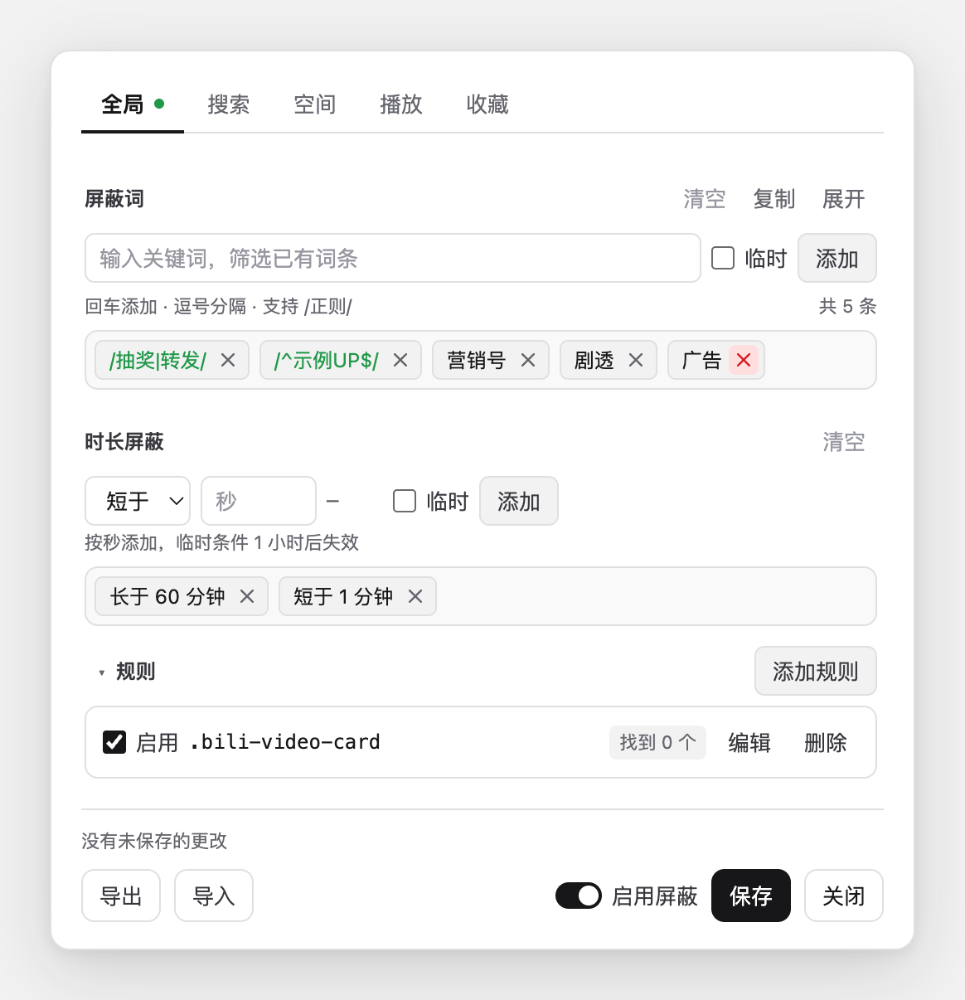
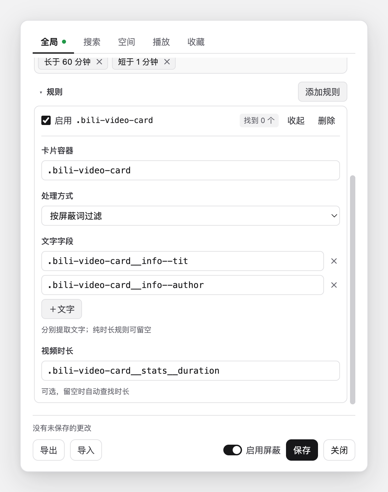

# Biliban

一个用于屏蔽 B 站指定内容的 Chrome / Edge 扩展。通过关键词、正则表达式和视频时长过滤卡片，也可以自行编辑页面选择器规则。

所有匹配在本地完成，无需登录或配置服务器。通过 ZIP 分发，不接入浏览器商店。



截图使用演示词条，首次安装时屏蔽词和时长条件为空。

## 功能

- 按标题、UP 主名等页面文字过滤，支持普通关键词和正则表达式。
- 分别管理全局、搜索、空间、播放、收藏页面的屏蔽设置。
- 按视频时长过滤，支持短于或长于指定秒数。
- 临时屏蔽词和时长条件固定一小时有效，刷新后仍保留。
- 在面板中编辑、启停或删除选择器规则，适应页面结构变化。
- 输入筛选已有词条，点击词条旁的 × 图标移除。
- 导入、导出 JSON 设置，同一浏览器配置下的多个标签页同步生效。

扩展按页面中的 HTML 和文字工作，实际覆盖范围取决于规则能否匹配当前页面。首次安装提供默认选择器规则，屏蔽词和时长条件为空，需要自行添加。

## 安装

需要支持 Manifest V3 的 Chrome 或 Edge。

1. 在项目的 **Releases** 页面下载 `biliban-版本号.zip`。
2. 解压到一个固定目录，确认目录中有 `manifest.json`。
3. 打开 `chrome://extensions` 或 `edge://extensions`，开启「开发者模式」。
4. 点击「加载已解压的扩展」（Edge 中可能显示为「加载解压缩的扩展」），选择刚才的目录。
5. 打开或刷新 B 站页面。

安装后请保留解压目录。直接使用源码时，也可以选择项目根目录，无需构建。

### 更新

先在面板中导出设置备份，再把新版本解压覆盖到原目录，在扩展管理页点击「重新加载」，然后刷新 B 站页面。

ZIP 安装不会自动更新。换浏览器、换浏览器配置或改变扩展 ID 后，设置不会自动迁移；卸载扩展也会清除本地设置，可通过导出的 JSON 恢复。

## 使用

把鼠标移到页面右下角，点击「屏蔽」打开面板。

1. 选择要管理的分类；不确定时可以先用「全局」。
2. 输入屏蔽词，按回车或点击「添加」。多个词可以用半角逗号分隔。
3. 点击「保存」，设置立即应用到当前页，并同步到其他已打开的 B 站标签页。

输入框也用于筛选已有词条：输入部分文字后，下方只显示包含该文字的词条。点击词条旁的 × 图标移除，保存后生效；清空输入框会重新显示全部词条。

筛选时会显示匹配数量；没有匹配结果时会提示。长词条默认按宽度省略，悬停可看全文；点击「展开」后完整显示，再点击「收起」返回。

「清空」后可以点击「撤销」恢复整组词条；继续编辑该列表或保存成功后，结束这次撤销。页脚显示未保存、保存中和保存结果；写入失败会保留编辑，可重试。「关闭」会丢弃尚未保存的编辑。

### 关键词和正则

每条规则可以提取多个文字字段，例如标题、作者名。各字段独立判断，任一字段命中即屏蔽。

| 输入 | 效果 |
| --- | --- |
| `广告` | 任一文字字段包含「广告」就屏蔽 |
| `/^某UP$/` | 某个完整字段等于「某UP」时屏蔽 |
| `/教程\|入门/` | 某个字段包含「教程」或「入门」时屏蔽 |
| `/example/i` | 不区分大小写匹配 example |

普通词对作者名也使用包含匹配。若要精确匹配某位作者，可使用 `/^作者名$/`；它仍会匹配规则提取的其他字段，不限定为作者字段。

### 页面分类

| 分类 | 对应页面 |
| --- | --- |
| 全局 | 在任意已注入扩展的页面执行全局规则；全局词条也参与各具体分类的过滤 |
| 搜索 | `search.bilibili.com` 下的页面 |
| 空间 | UP 主空间的投稿视频列表 |
| 播放 | 视频页、番剧播放页、收藏夹播放列表、稍后再看播放列表 |
| 收藏 | 稍后再看列表、UP 主空间收藏列表 |

首页、动态等未归入具体分类的页面，只执行全局规则。添加全局屏蔽词并不意味着所有页面元素都会被检查，还需要有规则定位对应的卡片和文字。

### 时长和临时屏蔽

在「时长屏蔽」区域选择「短于」或「长于」，输入秒数后添加。例如，短于 `60` 秒会过滤不足一分钟的视频，恰好一分钟不受影响。没有读到时长的卡片不会仅因为时长条件被屏蔽。

添加词条或时长条件前勾选「临时」，保存后固定一小时有效，到期不再参与匹配；重新加载时会清理已过期项。

### 编辑规则

展开分类下方的「规则」区域，点击某条规则的「编辑」，可调整：

- **卡片容器选择器**：定位要处理的元素。
- **文字选择器**：在容器内部提取标题、作者名等文字，可设置多个。
- **时长选择器**：指定时长元素；留空时自动查找形似时长的文字。
- **模式**：「按屏蔽词过滤」结合词条和时长条件判断；「直接隐藏」隐藏所有命中的容器。

纯时长过滤可以不填文字选择器。「直接隐藏」规则按自身启用状态执行，不受页脚总开关控制；要暂停它，请取消该规则的「启用」并保存。

规则折叠时单行显示选择器、匹配数量和操作；展开编辑后，各输入有固定字段标签，可选择处理方式。「找到 N · 隐藏 M」表示本标签页当前一轮的匹配结果；尚无统计时显示「找到 0 个」。若页面改版后找不到元素，需要检查并修改选择器。



## 数据和备份

设置保存在扩展的 `chrome.storage.local` 中，按浏览器配置和扩展 ID 隔离。本项目不上传设置，不读取远程规则，也没有跨设备云同步。

- **导出**：下载 `biliban-settings.json`，包含已保存的屏蔽词、时长条件和全部规则；临时词条不包含在内。
- **导入**：用 JSON 中的设置替换当前设置，建议先导出备份。
- **默认规则**：用于首次初始化。保存后以用户本地规则为准，升级扩展不会覆盖当前版配置中已经修改或删除的规则。

扩展自身的旧版配置 v2–v4 会先备份再迁移；不支持旧油猴脚本配置。网页规则失效时，可以在面板本地维护，或自行导入新的完整设置。

## 开发

需要 Node.js 24 或以上版本，以及 Bun 1.3.11。扩展运行时无第三方依赖，无需编译；开发依赖仅用于检查、测试和 ZIP 打包。

```sh
bun install --frozen-lockfile
bun run lint        # antfu ESLint，包含格式检查
bun run lint:fix    # 修复格式和可自动修复的问题
bun run test        # Vitest 单次运行
bun run test:watch  # Vitest 持续运行
bun run check       # lint + 测试
bun run package     # 检查通过后生成 ZIP 和 SHA-256 校验文件
```

测试使用 Vitest，请执行 `bun run test`，而不是调用 Bun 原生测试器的 `bun test`。代码风格统一使用 `@antfu/eslint-config`，不使用 Prettier。

安装依赖时，`simple-git-hooks` 会注册 pre-commit：提交前执行 lint 和测试，失败时阻止提交。hook 只检查，不自动修改或暂存文件；如需重新安装，执行 `bun run prepare`。

测试覆盖匹配、配置存储、迁移和 jsdom 下的面板交互，规则由测试自行提供。真实布局、浏览器扩展加载、跨标签同步及 B 站页面适配仍需手动验证，具体范围见 [测试说明](test/README.md)。

```text
src/content/
  config/     配置、存储、迁移和临时词条
  dom/        元素提取与隐藏操作
  engine/     页面分类、关键词与时长判断、调度
  panel/      设置面板
  rules/      首次初始化用的默认规则
  util/       输入解析等工具
test/         Vitest 单元测试和 jsdom 集成测试
scripts/      图标生成、ZIP 打包
```

### 发布

发布由维护者手动决定，不设置定时发版。

1. 更新 `package.json` 和 `manifest.json`，保持版本一致。
2. 执行 `bun run package`，用 `dist/biliban-版本号.zip` 手动安装验收。
3. 提交后推送对应的 `v版本号` 标签。
4. Actions 执行检查和打包，创建附有 ZIP、SHA-256 的 Release 草稿。填写更新说明，检查后发布。

PR 和推送 `main` 也会运行 CI，并上传预览包。分发 ZIP 只包含运行文件、图标、README 及其截图、LICENSE 和 NOTICE；完整开发源码通过对应版本标签提供。

## 来源与许可证

本项目基于 pana 的 [哔哩哔哩 - 屏蔽指定内容](https://greasyfork.org/zh-CN/scripts/397669) 修改，面板交互源自 [Block_Obj](https://greasyfork.org/scripts/407543-block-obj)。原项目使用 GNU GPL v3 或更新版本，本项目采用相同的 **GPL-3.0-or-later**。

本项目将原脚本改为 Manifest V3 浏览器扩展，并调整了过滤方式、页面分类、规则存储和设置面板。原作者署名与修改说明见 [NOTICE](NOTICE)，完整许可条款见 [LICENSE](LICENSE)。

你可以依照 GPL 使用、修改和再分发。分发修改版时须保留相关署名和许可声明、注明修改，并依照 GPL 提供对应源码；仅保留原项目链接不能代替这些义务。本软件不提供担保。
